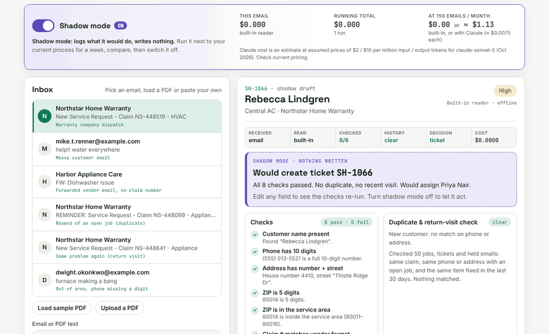
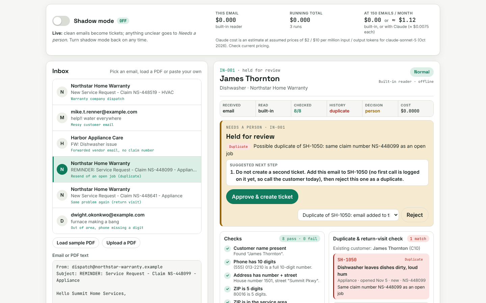

# Work Order Intake (M1: AI email intake to ticket)

Work-order emails and PDFs become checked service tickets. Every field is validated, duplicates and return visits are caught, and anything unclear goes to a person with the full story.

**Try it:** https://tedkelly.dev/projects/work-order-intake/



## The problem

Work orders reach a service business as emails, and no two look alike. A warranty company sends a formatted dispatch. A homeowner writes "help!! water everywhere" with the address buried in the middle. A vendor forwards a request and says the claim number will follow. The same claim gets sent twice. A customer writes in about the fridge your tech fixed three days ago.

Someone in the office retypes each one into the ticket system. That takes about five minutes per order, and details get missed: a phone number with a digit missing, a ZIP outside your area, a claim number in the wrong format that the warranty company will bounce at billing time, a second ticket for a job that is already booked. Warranty companies also grade you on how fast you make first contact, so a slow handoff costs you.

## What it does

- **Reads the email or PDF** and fills in the ticket: customer, phone, address and ZIP, claim number, warranty company, trade, equipment, a one-line problem summary and urgency.
- **Checks every field** against 8 plain rules and shows pass or fail with the reason.
- **Looks for duplicates and return visits** in your open jobs, completed jobs and today's tickets.
- **Decides:** a clean email becomes a ticket automatically, with a suggested tech, the first-call deadline and a ready-to-send text to the customer. Anything unclear goes to **Needs a person**.
- **Logs every run** in an activity log, with the cost of that run.

## Before and after

| | Before | After |
|---|---|---|
| Time per work order | ~5 minutes retyping | ~30 seconds to review, or none for clean ones |
| Field checks | Whatever the person notices | 8 checks on every ticket, every time |
| Duplicates (same claim sent twice) | Found when two techs show up | Caught before a ticket exists, with the matching job shown |
| Return visits | Billed as a new job, warranty company pushes back | Flagged as a recall, same tech, no new trip charge |
| Unclear emails | Sit in the inbox | Go to a person with a suggested next step |

## The safety rules it follows

1. **Shadow mode first.** On a first visit it runs in shadow mode: it logs what it *would* do ("WOULD create ticket SH-1066", "WOULD send to a person: duplicate of SH-1050") and writes nothing. In a real install you run it next to your current process for a week, compare, then switch it on.
2. **Validation on every field.** Phone must have 10 digits. ZIP must be 5 digits and inside the service area (80011 to 80016 for the demo company). The claim number must match the warranty company's format (`NS-######`, `BP#######`, `HAC-#####`) or be marked "to follow". The address needs a house number and street. Trade must be HVAC, Plumbing or Appliance. Customer name and problem must be present. A ticket with any failed check cannot be created automatically.
3. **Duplicate and return-visit checks.** A duplicate is the same claim number as an open job, or the same phone or address with an open job for the same trade and equipment. A return visit is the same customer and equipment with a job completed in the last 30 days, which is a warranty recall risk. It shows what it matched: job number, date and issue.
4. **Fail to a person, with full context.** Failed checks, low confidence, duplicates, return visits and emergencies go to a "Needs a person" queue with the original email, what was read, which checks failed and why, and a suggested next step. A person fixes the fields and approves (the checks re-run as they type), or rejects with a reason.
5. **Never drops work silently.** Nothing is deleted. Rejected items stay listed with their reason, and every run, approval and rejection is in the activity log. If the AI call fails, the built-in reader takes over (in n8n, the email goes to a person).
6. **Activity log.** Every run is logged with a timestamp: email received → read → checked (n pass / n fail) → duplicate check → decision → action or would-action.
7. **Rollback-friendly.** In shadow mode nothing is written anywhere, so turning it on or off is safe at any time.

## What it costs to run

- **Built-in reader:** $0.00 per email. Plain JavaScript rules, no AI, no server.
- **With AI (Claude):** less than one cent per email, typically about $0.005 to $0.01. The demo shows the cost of each run, a running total and the monthly cost at 150 emails (around $1). Prices are assumed list prices for `claude-sonnet-5` ($2 / $10 per million input / output tokens); the estimate uses the API's reported token counts, or about 4 characters per token. Check current pricing.
- **Running it for real:** the n8n version runs self-hosted (from about $5 a month for a small server) or on n8n Cloud.

## Try it

https://tedkelly.dev/projects/work-order-intake/

1. With shadow mode on, click a few emails in the inbox. Watch the decision, the checks and the activity log. Nothing is created.
2. Turn shadow mode off. Click **Harbor Appliance Care** (a forwarded email with the claim number "to follow"): it becomes ticket SH-1066.
3. Click **Resend of an open job**: it is the same claim as SH-1050, so it goes to **Needs a person** instead of becoming a second ticket.
4. Click **Out of area, phone missing a digit**. Approve is blocked. Fix the phone and ZIP in the ticket fields and approve it.
5. Click **Load sample PDF** to run a PDF work order through the same steps.

To try the AI path, open "Use Claude to read the email" and paste your own Anthropic API key. It goes straight from your browser to `api.anthropic.com` and nowhere else.



## n8n version

The same flow as an importable n8n workflow: Gmail trigger → Claude (Messages API, key from an environment variable) → validation rules → duplicate check against a Google Sheet → shadow-mode switch → Slack message to a person, or a new row in the Tickets sheet. Failed AI calls retry 3 times and then go to a person; an error workflow alerts Slack. See [`n8n/README.md`](n8n/README.md).

## How it is built

- `index.html`, `app.css`: the page (shared tokens from `shared/demo.css`).
- `app.js`: `window.Intake`, pure functions you can run in Node (`parse`, `validate`, `checkHistory`, `decide`, `evaluate`, cost estimates, the extra sample emails), plus the UI.
- `samples/sample-work-order.pdf`: a synthetic Northstar Home Warranty work order. PDFs are read in the browser with pdf.js (loaded from cdnjs on first use).
- `n8n/`: the n8n workflow and its error workflow.
- `shared/data.js`: the fictional company, techs, vendors, customers and jobs (`window.SUMMIT`).

Run the pipeline in Node:

```js
global.window = global;
require('shared/data.js');
const I = require('./app.js');
const e = I.SAMPLES[0]; // resend of an open job
const r = I.parse(`From: ${e.from}\nSubject: ${e.subject}\n\n${e.body}`, SUMMIT);
const ev = I.evaluate(I.toTicket(r), r, SUMMIT, { tickets: [], pending: [] });
console.log(ev.decision.route, ev.history.duplicates, ev.rules);
```

Tickets, the Needs a person queue, the activity log and the shadow-mode setting are saved in `localStorage` (wrapped in try/catch, so it still works in a private window, just without saving).

## Built with

Plain HTML, CSS and JavaScript, no framework and no build step, hosted on GitHub Pages. pdf.js for PDFs. Claude via the Anthropic Messages API is optional. n8n for the production version.

## Note

Summit Home Services, Northstar Home Warranty, Bluepeak Protection Plans and Harbor Appliance Care are fictional. Every name, address, phone number and claim number in this demo is made up.

## Run it locally

No install or build step. Clone the repo and open `index.html` in a browser, or serve the folder:

```bash
git clone https://github.com/TedKelly561/work-order-intake.git
cd work-order-intake
python3 -m http.server 8000   # then open http://localhost:8000
```

`shared/data.js` holds the fictional company (Summit Home Services) shared by every demo in the toolkit.

## More from the toolkit

- [Work Order Intake](https://github.com/TedKelly561/work-order-intake): messy email → checked service ticket
- [Quote Builder](https://github.com/TedKelly561/quote-builder): price-book quotes with margin view and approve links
- [Dispatch Board](https://github.com/TedKelly561/dispatch-board): drag-and-drop dispatch with first-call deadline alerts
- [Owner's KPI Dashboard](https://github.com/TedKelly561/kpi-dashboard): the numbers that run a service business

## About

Built by **Ted Kelly**: I build automations for field service, repair and warranty businesses, switch them on safely, and keep them running. See the [safety method](https://tedkelly.dev/safety/) or book a free 20-minute call at **[tedkelly.dev](https://tedkelly.dev)**.

## License

[MIT](LICENSE). All companies, people, addresses and claim numbers in this demo are fictional.
